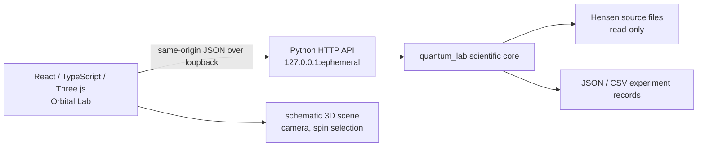

# Архітектура Quantum Laboratory

## Межа фізики й інтерфейсу

The browser owns presentation state, camera navigation, panel visibility and playback over saved numerical points. It does not implement the physical models. Requests cross the local same-origin HTTP API; the API dispatches to the same Python functions used by the scientific and regression tests.

## Main modules

- `quantum_lab/`: Bell-state preparation and measurements, local Kraus maps, multispin operations and partial traces, OBC TFIM and time propagation, Dynamic Receiver, deviation analysis, Hensen reanalysis, provenance and experiment storage.
- `quantum_lab/http_api.py`: loopback HTTP adapter, route validation, structured errors, static frontend serving, record access/comparison/export, a 64 MiB request-body limit and admission control that allows one memory-heavy POST at a time. Concurrent POSTs receive a structured `503 server_busy`; health, GET, and static-file requests remain available.
- `scripts/launch_local.py` and `start_windows.bat`: isolated Python setup, locked frontend install/build, OS-assigned loopback port, readiness checks and startup logging.
- `frontend/src/App.tsx`: mode orchestration and Python API calls. Components under `frontend/src/components/` implement the scene, Inspector, panels and plots.
- `frontend/src/components/ScientificDocumentation.tsx`: local searchable 21-topic handbook; `Math.tsx` renders reviewed static formula strings with the bundled KaTeX renderer. `frontend/src/docs/references.ts` is the in-app citation registry and `docs/references.bib` is its human-readable BibTeX counterpart.
- `frontend/src/components/ParameterHelp.tsx`: accessible parameter definitions that navigate to a matching handbook topic; it does not calculate any physical quantity.
- `app.py`: legacy Streamlit presentation for the original research workflows. Its calculation logic delegates to `quantum_lab`.
- `data/references/`: versioned raw Hensen 2015/2016 inputs and manifests. Reanalysis reads and validates these files; it does not modify them.
- `results/stage5b/`: preregistration, research records and independent-validation artifacts. Treat these as historical research outputs, not disposable UI cache.
- `results/ui_experiments/`: local user exports; excluded from version control by default.

## Data meaning

The UI labels exact expectations, numerical trajectories, random finite-shot measurements and published-data reanalysis separately. A displayed trajectory is a sequence of computed values; it is not continuous observation of a single quantum system. Spin locations and Bloch vectors are schematic views of Python outputs, not calibrated spatial motion.

The experiment comparison endpoint reports matching configuration fields and shared finite scalar paths descriptively. It does not rerun a model, estimate a new statistical test or claim physical equivalence.

The handbook data, KaTeX styles, and fonts are bundled with the frontend. Mathematical expressions are static, reviewed application content; raw user-entered strings are not sent to an HTML math renderer. API results remain Python-owned. `Timeline` may format a known static scientific label as TeX, but its numeric series is still the API response.

## Run boundary and current limitations

The supported Windows entry point is `start_windows.bat`. It selects a free loopback port through the OS and checks the Python health route and built UI before opening the URL. The server is a local single-user research preview, not an authenticated network service. Do not expose it on a LAN or public interface.

The registered TFIM solver supports cancellation callbacks at the Python API level and bounds saved snapshots; the browser HTTP route does not currently expose a user cancellation job protocol. Closing a browser request may leave its current Python calculation running until that request finishes. Restarting the UI does not corrupt saved experiment records.

More details on physical assumptions and evidence are in `SCIENTIFIC_METHODS.md`, `EXPERIMENT_RESULTS.md` and `docs/scientific_model.md`.
